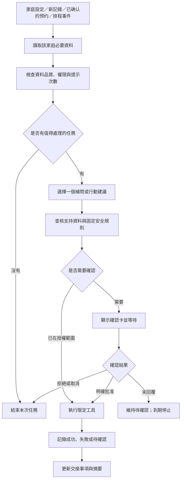

# 育伴港 CareLoop HK：香港新手家庭主動照護協作助理

導師跟進與原型方案 v0.2｜資料查核日期：2026-09-19

本文件是可供組員與導師討論的原型方案，尚未代表產品已建成、已有合作機構或已驗證成效。用戶已確認目前沒有報名比賽，計劃先完成項目再尋找合適比賽；現時要求是每週提交四份個人 log 供導師建議和跟進。團隊由一位主力使用 AI 開發、兩位提供工具經費、另一位協助；具體工具、預算與個人本週行動尚未提供。暫以六週作可調整的原型週期，並非外部截止日期。名稱屬暫定工作名稱，未查核商標。

## 1. 建議採用的定位

**一句話：當新手家長還不知道該問甚麼，育伴港會根據家庭已確認的記錄，適時補問關鍵資料、協助照顧者交接，並整理出有依據、可核對的照護摘要。**

正式題目建議：**「育伴港：面向香港新手家庭的主動式 AI 照護協作助理」**。

原構思最值得保留的是「新手不知道自己需要問甚麼」。產品應減少家長記憶、整理和協調的負擔。首版服務對象是照顧 0–12 個月嬰兒的成年家長和獲授權照顧者，主場景是日常記錄、交接與覆診準備。0–10 歲保留為長期路線。

建議對外避免使用會令人誤以為有人持續看顧孩子的「AI 護工」「全天候安全監護」表述。產品實際能做的是處理已取得的資料與執行有限任務；日常觀察與照顧仍由真人完成。

## 2. 問題、證據與待驗證假設

| 問題假設 | 產品回應 | 如何驗證 |
|---|---|---|
| 家長不知哪些觀察值得記下 | 在交接或覆診等具體時機提出一個相關問題 | 訪談近期經歷；測試問題是否有用 |
| 抱着孩子時不方便逐格填表 | 粵語／文字一次輸入，顯示確認卡 | 計時與關鍵欄位錯誤率 |
| 父母、祖父母及其他照顧者資訊分散 | 共用事件時間軸與待確認交接事項 | 對照任務中下一位照顧者取得的關鍵事實 |
| 到診時難回想事件與時間 | 自動草擬一頁摘要及問題清單 | 家長完成準備的時間；專業人士可讀性回饋 |
| 主動通知可能增加壓力 | 合併提醒、安靜時段、次數上限及暫停 | 有用提示比例、打擾評分與關閉原因 |

以上是需要測試的產品假設，不能寫成「香港大部分家長都如此」或已證實改善焦慮。

香港已有可互補的官方服務：母嬰健康院提供親職教育、免疫接種及健康與發展監察；兒童發展監察亦重視家長和照顧者的觀察，設有到診前填寫問卷的安排。因此「幫家長整理觀察與準備問題」有具體服務場景。來源：[兒童健康服務](https://www.fhs.gov.hk/tc_chi/main_ser/child_health/child_health.html)、[兒童發展監察計劃](https://www.fhs.gov.hk/tc_chi/health_info/child/13033.html)。

## 3. 現有服務與參賽差異

| 已核實的服務 | 已有能力 | 對本項目的啟示 |
|---|---|---|
| 香港《親子一點通》 | 按兒童年齡定期以電郵提供育兒資訊 | 「適齡推送」本身不足以成為創新主張 |
| 醫健通 | 部分健康紀錄、兒童成長和疫苗資料、預約加入日曆及提示 | 要補足家庭日常協作，避免只重做健康紀錄庫 |
| Huckleberry Berry | 利用孩子記錄提供個人化回應；照片、語音、文字記錄 | 「AI＋多模態＋個人化」已有產品實現 |
| Nara Baby | 日常記錄及多照顧者資訊協作 | 共用記錄是基本能力，應驗證交接品質是否更好 |

來源：[親子平台](https://www.fhs.gov.hk/tc_chi/parenting_corner/)、[醫健通功能](https://www.ehealth.gov.hk/tc/you-and-your-family/mobile-app.html?f=478)、[Berry 官方產品頁](https://huckleberrycare.com/product/berry)、[Nara 官方產品頁](https://nara.com/pages/nara-baby-tracker-app)。表格只描述已查到的功能，沒有核實的功能不能標示競品「沒有」。

**本項目的差異化假設：**香港情境下的粵語輸入、按家庭任務主動補問、低打擾交接，以及把每項摘要連回原始記錄和參考來源。這個組合需要以任務測試證明價值，暫不宣稱「香港首創」或「市場唯一」。

## 4. 年齡與功能範圍

| 階段 | 對象 | 範圍 |
|---|---|---|
| 導師演示 MVP | 0–12 個月嬰兒家庭 | 日常事件記錄、資料補問、兩位照顧者交接、已確認預約提醒、摘要 |
| 下一階段 | 1–5 歲家庭 | 經審閱的親職資訊、幼兒生活習慣及到診準備 |
| 再下一階段 | 6–10 歲家庭 | 學校通知、學生健康檢查準備、較適齡的私隱與參與設計 |

學生健康服務另有周年評估、學校通知和預約流程，並非把嬰兒資料換成學齡資料便足夠。來源：[學生健康服務常見問題](https://www.studenthealth.gov.hk/tc_chi/faq/faq.html)。

早產、慢性病或需要特別照護計劃的兒童，首版只容許記錄及整理已確認的安排；不根據一般年齡資料生成個別照護計劃。實際納入試用的範圍需先界定。

## 5. 如何讓忙碌家長願意使用

首次設定盡量只需要：孩子暱稱／年齡資訊、主要照顧者、關注事項、通知時段。精確出生日期只有在需要計算月齡且家長願意提供時收集；無需要就不收身份證、出生證明或住址。

提供三種使用方式：

- **輕量模式：**只用年齡、已確認預約與家長選定目標提供提示；沒有生活記錄就不聲稱了解孩子當日狀況。
- **日常模式：**一句語音或幾個按鈕完成事件記錄，家長選擇哪些項目值得追蹤，無須每天填滿清單。
- **協作模式：**已獲邀照顧者共用必要記錄，在交接前確認待辦事項。

首頁只突出「現在最值得處理的一件事」，下方才是時間軸、稍後處理與資料來源。避免一開啟就展示大量健康評分或紅色警報。

照片應是自願、具體用途的輸入，例如拍攝已遮去不必要個資的預約便條，擷取日期後由家長確認。每日拍攝孩子外貌的價值尚未證實，不應設定成必填任務。

## 6. MVP 必須跑通的五個模組

| 模組 | 最小可交付行為 | 驗收重點 |
|---|---|---|
| 輕鬆記錄 | 粵語／文字轉成時間、事件、數量、單位、記錄者；確認後入檔 | 模糊數字或單位會補問；保留約數與更正 |
| 主動補問 | 在家庭設定的交接時機，對相關缺项詢問一次 | 「未記錄」不被寫成「沒有照顧」 |
| 提醒與交接 | 執行已確認的時段及家庭協作規則 | 對象、次數、權限與結果可查看 |
| 官方資訊卡 | 從小型、已審阅的來源庫檢索相關內容 | 每項實質建議有支持內容及適用範圍；找不到便說明 |
| 可追溯摘要 | 根據已確認記錄草擬一頁摘要，附原始記錄與缺項 | 可逐條核對；更正資料後重新生成 |

照片 OCR 可作第二優先功能；若核心流程未穩定，先保留附件與人工輸入。可用性優先於功能數量。

## 7. 主動 Agent 實際如何運作

AI 用來理解口語、選擇需要補問的資料及整理摘要；固定日期計算、權限、通知上限和數值統計交由確定性程式處理。流程不需要多個 AI 輪流聊天才算 Agent。

每項任務有「草稿 → 待確認 → 已排程 → 已執行／失敗／取消／過期」狀態。工具執行當下重新檢查權限及事件是否已取消；相同事件只執行一次，避免重試時重複發送。失敗需有有限重試與可見結果，不得讓 AI 無限循環找人。

通知初始設計可採「當天有已定義任務時，至多一次合併提示」、每項非緊急任務最多一次跟進，另設家庭自行建立的預約提醒；這些是待測試設定，不是醫療標準。沒有任務時不喚起模型或發問候。到達上限、安靜時段或用戶暫停時，停止非緊急主動提示。未回覆只代表任務待確認。

## 8. 工具權限設計

以下為產品建議，並非逐項法律結論。

| 行動 | 自動化條件 | 原型處理 |
|---|---|---|
| 整理記錄、產生摘要草稿 | 限該家庭已授權資料與用途 | 自動執行，標示草稿 |
| 向本人推送例行提示 | 事先設定時段、頻率與通知權限 | 可自動執行，可暫停 |
| 新增／更改日曆事件 | 確認日期、內容與相關權限 | 先預覽；已確認事件可按設定提醒 |
| 向家庭成員發交接通知 | 已加入家庭、明確接受角色及可見資料範圍 | 只通知指定測試帳戶 |
| 無回覆後請備用照顧者協助確認 | 事前明確設置触發條件、對象、內容和次數 | 可演示一次一般協作請求，不標示孩子遇險 |
| 外部短訊／即時通訊 | 核實渠道能力，具體收件人與內容獲授權 | 首版用發送預覽或測試收件者；不依賴私人帳號自動化 |
| 匯出／分享摘要 | 家長確認內容、期間、附件及收件對象 | 匯出供家長自行提供，分享另行操作 |
| 更新官方知識 | 白名單抓取→比對變更→審閱→發布版本 | 新網頁不直接成為照護規則 |
| 開鏡頭、讀整個相簿、後台錄音 | 無此產品必要性 | 不提供 |
| 自行找人、增加收件者或調整用藥 | 超出首版用途及授權 | 不提供 |

父母無回覆不是擴大授權的理由。通知已傳送也不等於對方已閱讀、已確認或已完成照顧，介面應分別顯示。

香港私隱專員公署曾專門就 OpenClaw 與代理式 AI 提醒最小權限、系統隔離及人類控制等風險管理需要。這支持以有限工具及可撤銷授權實現你們「像龍蝦，自動行」的想法。來源：[PCPD 2026-03-16 提醒](https://www.pcpd.org.hk/english/news_events/media_statements/press_20260316.html)。

## 9. 資料來源與「自動上網」

必須分開三類資料：

| 類型 | 例子 | 使用方式 |
|---|---|---|
| 家庭事實資料 | 照顧者觀察、已確認預約、家長提供文件 | 顯示記錄者、時間與確認狀態；只在家庭權限内處理 |
| 公開參考知識 | 香港政府育兒資訊、服務地址、到診文件清單 | 受控檢索；註明來源、適用年齡、修訂及查核日期 |
| 外部說法 | 社交貼文、網上育兒建議 | 可由家長主動分享作查證材料；不能直接視為個人事實或照護依據 |

政府網站有公開資料，並不等於提供個別孩子的病歷、預約或學校資料接口。本次查閱沒有確認一般第三方 App 可直接讀取醫健通兒童病歷的公開 API；原型採家長主動提供和確認，不展示成已接通政府系統。醫健通本身有認證及照顧者管理安排。來源：[醫健通功能及照顧者說明](https://www.ehealth.gov.hk/tc/you-and-your-family/mobile-app.html?f=478)。

知識庫先整理約 5 項與到診準備及本地服務直接相關的官方內容，六週內視需要逐步擴展至約 20–30 項。每項建立來源卡：標題、發布機構、URL、段落位置、適用對象、網頁修訂日期、團隊查核日期、版本、審閱狀態及內容使用條款。不可把重新抓取日期冒充官方更新日期，也不可暗示政府背書。

建議更新流程：

1. 定期檢查白名單來源，記錄變更；來源失效時標示不可用。
2. 抽取相關段落與舊版本比較，人工核對適用範圍及原文限制。
3. 一般服务資訊經內容審阅；涉及健康決策的內容需合資格專業人士審閱後才可發布到相應功能。
4. 檢索已發布版本，產生答案時把實質建議逐項對回來源。
5. 來源不足、互相矛盾或超出適用範圍時，不編造個別照護結論。
6. 保留版本与停用能力；重要更正需能找出受影響的建議记录。

這是可核查的知識更新，不是 AI 每天上網後自行學會新的醫療規則。檢索能降低部分錯誤，仍需檢查引用是否真正支持說法。

社交媒體分兩條路：追蹤政府公開教育資訊可納入來源審查；家長主動分享一則貼文可作查證。首版不監控私人帳戶、私聊或兒童動態，也不根據貼文推斷孩子健康。公開可見的個人資料不代表任何用途都獲同意。來源：[PCPD 公開領域個人資料指引](https://www.pcpd.org.hk/english/resources_centre/publications/guidance/files/GN_public_domain_e.pdf)。

本地來源可從以下入口開始：

- [家庭健康服務兒童資訊](https://www.fhs.gov.hk/tc_chi/health_info/child.html)：按年齡與主題建立內容索引。
- [到訪兒童健康服務須帶文件](https://www.fhs.gov.hk/tc_chi/doc_br/child_health_service.html)：生成準備清單；App 摘要不取代正式文件。
- [母嬰健康院目錄](https://www.fhs.gov.hk/tc_chi/centre_det/maternal/maternal.html)：服務導航，顯示查核時間。
- [暫託幼兒服務開放資料](https://data.gov.hk/tc-data/dataset/hk-swd-fcw-list-occs)：後續支援探索；名單不等於即時有空缺或已預約成功。

## 10. 專業人士可快速讀懂的報告

報告名稱建議用「家庭照護記錄摘要」，標示「家長提供資料／AI 協助整理／未作醫療診斷」。能追溯有助發現錯誤，不能保證沒有幻覺；保護措施必須在生成前、生成中和核對時都存在。

一頁主摘要包含：

1. 孩子暱稱、年齡、報告期間、生成時間與版本。
2. 家長最想問的三個問題，盡量保留原意。
3. 已記錄事件及重要更正，標示事件時間、記錄時間與記錄者。
4. 資料完整度，例如「七天中有三天提供此項記錄」，不把空白視作零。
5. 已確認的預約及需帶備文件。
6. 待確認、彼此衝突或不能判斷的項目。
7. 家長核對狀態；報告對應原始記錄和參考內容的索引。

附錄可供展開：原始文字、可選附件、修訂歷史、引用段落及版本、工具執行結果。報告中的計數與總量由程式計算，AI 負責表達；不讓模型憑語意猜數字。

**格式示例，以下全為合成資料：**

| 欄位 | 示例 |
|---|---|
| 家長原話 O-014 | 「今朝十一點左右飲咗約一百二十毫升奶。」 |
| 確認記錄 | 照顧者 A；約 11:00；奶；約 120 mL；家長已確認 |
| AI 可寫的摘要 | 「已記錄約 11:00 飲奶約 120 mL。」 |
| AI 不可推論 | 「今日攝取充足」「沒有脫水」「未記錄的時段没有飲奶」 |
| 資料缺項 | 其他時段未提供記錄，全天總量不能確定 |

若原始附件已按設定刪除，需明示無法再查看該附件；保留的確認文字不是原始影像。用戶刪除相關個人資料時，同步處理摘要、搜尋索引及快取，並說明備份清理週期。已经由用户下载或发出的文件不能承諾遠端收回。

醫護是否願意使用此格式仍需訪談驗證；不能寫成已獲臨床認可或可直接寫入醫院病歷。

## 11. 安全、私隱與信任

| 容易出錯的情況 | 產品處理 |
|---|---|
| 語音把 120 聽成 20、漏掉單位 | 顯示待確認欄位；不直接觸發相關計劃 |
| 不同照顧者記錄矛盾 | 兩筆均保留並標為衝突，補問，避免靜默覆蓋 |
| 沒有人回覆或整天沒有資料 | 標示未知，依既定提醒上限停止；不判斷失職或健康正常 |
| 用照片詢問黃疸、脫水或發育障礙 | 不由照片給診斷或排除疾病；引導適切求助 |
| 想依一般網文改藥物或劑量 | 首版不支援；不自動更改專業人士的安排 |
| 用戶描述緊急求助需要 | 顯示清楚的即時求助入口；不等候完成聊天或找家人才提示求助 |
| 鎖屏、匯出或家庭邀請洩漏資料 | 鎖屏隱藏健康詳情；分享前預覽；每人獨立權限及撤銷 |
| 家長私人壓力記錄被其他照顧者看到 | 個人與共用資料分開設權限，按必要性分享 |
| 網頁或附件藏有指令要求外傳資料 | 外部內容只作資料；工具權限由獨立程式檢查 |
| 網絡失效、AI 不可用或推送失敗 | 保留未送出的輸入並顯示失敗；AI 故障時仍可用基本表單。完整離線記錄與跨裝置同步列為後續功能，未實現前不宣稱支援 |

一般緊急求助頁可依消防處指引，協助使用者查看並提供事發地址、聯絡電話和傷病情況，並由使用者操作 999 撥號。醫療分流若成為功能，需獨立的專業規則審閱與驗證，不能把幾個關鍵字測試當完整安全系統。來源：[消防處召喚服務資料](https://www.hkfsd.gov.hk/chi/fire_ambulance_services/fire_information.html)。

資料保護的實作要求：

- 只收功能所需資料；按鍵錄音、主動選圖，讓家長選擇是否保存原音與原圖。
- 雲端處理前清楚說明資料類型、目的、供應商與處理地區；核查供應商條款是否支持所承諾的保存與不作訓練設定。
- 傳輸與儲存加密；每個家庭資料隔離；伺服器端檢查角色與權限，不能只靠畫面隱藏。
- 提供查閱、更正、匯出、刪除、退出家庭及撤銷存取；另定各類資料的保留期限和備份清理流程。
- 稽核只記必要的輸入索引、規則／模型版本、授權、工具參數與結果，不保存額外私密推理內容。
- 演示及首輪測試使用合成孩子資料；與成年家長訪談也應避免收集不必要的真實兒童病歷。

這些設計參考 PCPD 的 AI 風險與兒童資料最小化原則，並非已取得合規認證。兒童指引主要針對向兒童收集資料的服務，家長端產品可借鑑其設計原則。來源：[PCPD 兒童資料收集指引](https://www.pcpd.org.hk/english/resources_centre/publications/files/guidance_children_e.pdf)。

香港衞生署 TR-007:2026 按實際用途界定軟件醫療器械，涉及診斷、篩查、疾病監測等功能需另作適用性評估。把產品叫「助理」或加上「非醫療建議」字句不會自動確定其監管地位；首版用途須與實際行為一致，上線前針對最終功能評估。來源：[TR-007:2026](https://www.mdd.gov.hk/filemanager/common/mdacs/TR007E.pdf)。

## 12. 技術實現與成本控制

建議架構是「手機介面＋家庭資料庫＋排程／事件服務＋受控 AI 處理＋限定工具」，不在手機保持高權限 Agent 全天運行。

手機負責輸入、確認、查看與本地提醒；伺服器在有新事件或到指定時間時處理任務。iOS 背景工作由系統決定執行時機；Android 的週期背景工作也不保證精確時間。不能承諾 App 被關閉後仍持續觀察或每次通知必達。來源：[Apple 背景策略](https://developer.apple.com/documentation/backgroundtasks/choosing-background-strategies-for-your-app?changes=_5)、[Android 週期工作](https://developer.android.com/reference/androidx/work/PeriodicWorkRequest.Builder)。

原型復用方向：優先評估 Baby Buddy 的記錄底座，先用手機瀏覽器可操作介面完成單一合成家庭示範，另外加入任務、授權及來源模組。未確認其家庭隔離、撤權及稽核能力前，不開放多家庭真實資料。詳見 OPEN_SOURCE_REUSE.md；目前只完成資料研究，未下載或運行候選程式。

最小資料物件：

- ChildProfile：孩子與家庭的最低必要設定。
- CareEvent：事件時間、記錄時間、數值、單位、約數、來源與確認狀態。
- ConsentPolicy：各照顧者權限、提示上限、可用工具及授權版本。
- Task：觸發事件、待辦事項、收件人、期限、狀態與去重識別。
- SourceCard：來源段落、年齡／場景限制、版本及審閱狀態。
- ActionAudit：工具、授權、执行時間、成功／失敗與必要參數。
- Report：涵蓋記錄、生成版本及家長確認狀態。

檢索內容庫與家庭個人資料應分開存放。技術選型待確認團隊能力後再定；先選單一手機平台或手機尺寸可操作原型。若用模擬推送、測試簡訊或桌面展示，需在答辯中如實標示。

成本項目包括：語音轉錄、模型輸入輸出、圖片處理、資料儲存、通知／簡訊、部署、測試設備及專業內容審閱。先限制非必要模型调用，固定規則不反覆問 AI；同一官方資訊可快取。

**只作容量估算的示例：**若 1,000 個家庭平均每天 5 次模型調用，每 30 天是 150,000 次。實際費用須用所選供應商的當期單價，乘以實測輸入／輸出量及其他成本；此例不是報價或收入預測。設定每家庭及全系統預算上限，避免 Agent 重試造成費用失控。

## 13. 六週實作與四人分工

已知分工是 A 主力使用 AI 開發、B／C 提供工具經費、D 協助。下表把目前角色與建議新增任務分開；只有真的做過才計入個人 log。出資不自動等於做過技術選型，購買一次也不應每週寫成新的成果。

| 角色 | 目前已知角色與建議後續工作 | 可核對成果 |
|---|---|---|
| A：你 | 主力用 AI 製作；負責範圍、整合與驗收 | 決策記錄、程式版本、演示錄影 |
| B：出資成員 1 | 已知提供經費；建議自願承擔工具成本／功能比較及少量來源核查 | 真實採購與費用表、比較依據、核查修訂 |
| C：出資成員 2 | 已知提供經費；建議自願承擔另一部分費用管理及獨立情境試用 | 真實費用表、實際試用筆記、錯誤截圖 |
| D：協助成員 | 協助具體事項待分配；建議負責測試復現、資料整理和演示 | 測試表、缺陷單、整理前後版本 |

以下是後續可認領的工作，B／C 若不認領新增任務，就據實記錄其資源支持與本週有無新增行動，不補造開發貢獻。

| 週次 | 共同成果 | 建議 A／B／C／D 當週重點 |
|---|---|---|
| 1 | 定義問題、MVP 與開源候選，請導師評議 | 範圍／工具比較／獨立閱讀方案／整理疑問 |
| 2 | 跑通底座與手機流程 | 原型／費用上限／流程試用／固定案例 |
| 3 | 輸入→確認→記錄→更正 | 開發／少量來源核查／粵語試用／資料錯誤測試 |
| 4 | 主動補問與交接 | 排程及工具／用量記錄／打擾評估／權限及失敗測試 |
| 5 | 摘要及小型對照測試 | 報告／引文核對／參與測試／統計與缺陷 |
| 6 | 修復、向導師演示與回顧 | 穩定版本／成本總結／整理回饋／錄影和材料 |

每週導師跟進只抓三件事：上週建議如何落實、本週能展示甚麼、新增哪個需要判斷的問題。只有原型與驗證到一定程度後，才按適用主題、團隊資格、AI／開源規則、截止日期與成果要求篩選比賽。

時間不足時依序刪除：自動外部訊息、照片 OCR、額外語言及額外年齡段。保留「記錄—補問—交接—可追溯摘要」的完整流程。

## 14. 如何證明它有效

三個層次分開呈現：

1. **需求研究：**先訪談約 5–8 位成年新手家長或照顧者，問最近一次具體交接／覆診準備經歷，不只問「你會不會用 AI」。這是探索樣本，不能推算全港需求。
2. **工程與安全測試：**先覆蓋當週新增功能的必要案例，六週累積約 40–60 個合成案例，涵蓋模糊時間、漏單位、重複記錄、衝突、沒有回覆、權限撤銷、跨家庭查閱、重試、過期任務、來源不足及惡意附件指令。涉及隔離、撤權及去重的檢查需在對應功能開放前完成。
3. **可用性對照：**用相同合成情境比較「普通記錄＋固定提醒」與「主動補問」，交替測試順序，記錄時間、遺漏、提示數及打擾感。需要時邀請合資格人士審閱報告格式，不虛構已完成審閱。

| 指標 | 定義 | 原型驗收方式 |
|---|---|---|
| 關鍵欄位準確性 | 確認前正確提取欄位／人工標注欄位 | 分別報時間、數值、單位，不只報總分 |
| 摘要追溯覆蓋 | 能定位原始記錄或來源的事實陳述／全部事實陳述 | 完整追溯作為驗收要求，仍需檢查來源是否支持 |
| 越權行動 | 無有效授權的工具執行次數 | 固定案例中必須為零；出現一次即阻止發布 |
| 交接完整性 | 接班者成功取得的關鍵事實／情境所需事實 | 與基線比較，報樣本與實際分數 |
| 使用負擔 | 記錄、交接、準備摘要的時間與打擾評分 | 不预先声称改善百分比 |
| 提示有用性 | 有對應任務且測試者認為有用的提示／全部提示 | 同時報過多提示、錯過任務與關閉原因 |
| 失敗處理 | 去重、撤權、失效來源及工具失敗案例結果 | 必須可見，不能把失敗顯示為已完成 |

零越權及完整追溯是有限測試集的通過條件，不代表真實世界風險為零。未經相應研究，不能聲稱改善兒童健康、減少急症、準確診斷或降低父母焦慮。

## 15. 商業與持續運作

先驗證價值再決定收費：家庭是否持續使用交接與摘要、哪一個功能願意付費、免費官方服務已滿足哪些需要。可探索個人家庭增值訂閱，或由家庭服務機構提供的試點服務；兩者都是待驗證路徑，不是已落實合作。

競爭優勢需要累積：經授權且去識別化的可用性回饋、香港口語測試案例、可審閱來源卡、可靠的家庭權限及交接體驗。孩子私密資料的數量不應被當作主要護城河。

首批接觸建議以家長社群和家庭服務工作者的研究訪談為主。正式收集真實家庭健康資料前，完成權限、刪除、保安、供應商及適用要求評估。引用政府資料不等於政府合作、認可或提供診療支援。

## 16. 擴展性如何表述

可復用的是輸入、記錄、任務、權限、通知、審計和摘要模組。轉向長者、復康或其他照護場景時，需要重做專業知識、決策規則、同意與代理權、緊急流程及驗證。不能宣稱「只換資料庫即可通用」。

## 17. 參賽交付清單與目前狀態

| 交付項目 | 目前狀態 |
|---|---|
| 構思定位、MVP、安全設計與香港來源 | 本文件已草擬，待團隊決策及核對 |
| 四分鐘演示故事、講稿、評委問答 | 已另附 PITCH_AND_DEMO.md |
| 四人分工與每週 log 模板 | 已另附 WEEKLY_LOGS.md |
| 比賽規則與 AI 使用／申報要求 | 尚未選定比賽，留待原型成熟後查核 |
| 開源候選與復用評估 | 已另附 OPEN_SOURCE_REUSE.md；未運行候選程式 |
| 可运行原型、正式 PPT／影片 | 尚未製作 |
| 家長訪談、專業審閱、實際測試結果 | 尚未進行 |
| 費用與技術選型、真實渠道整合 | 待原型範圍及資源確認 |

下一個具體里程碑：現在先凍結一頁 MVP 範圍，評估開源底座能否跑通「記錄與更正」，把可操作結果、復用清單與需導師建議的問題放入首輪週報。毋須等待找到比賽才開始製作。
