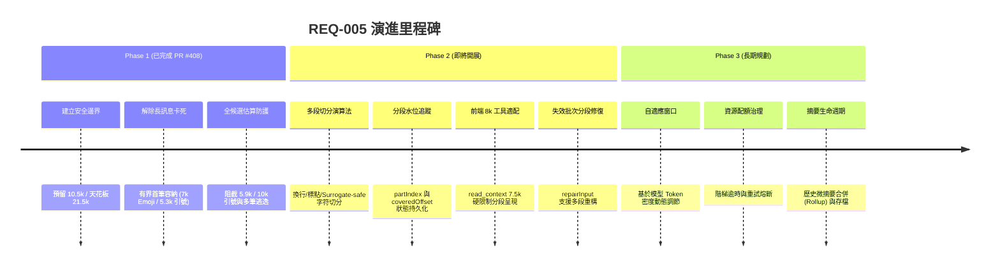
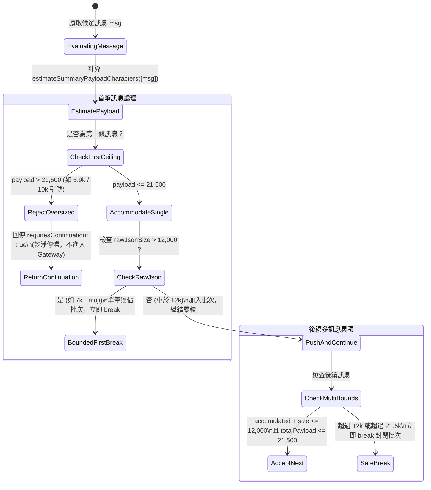
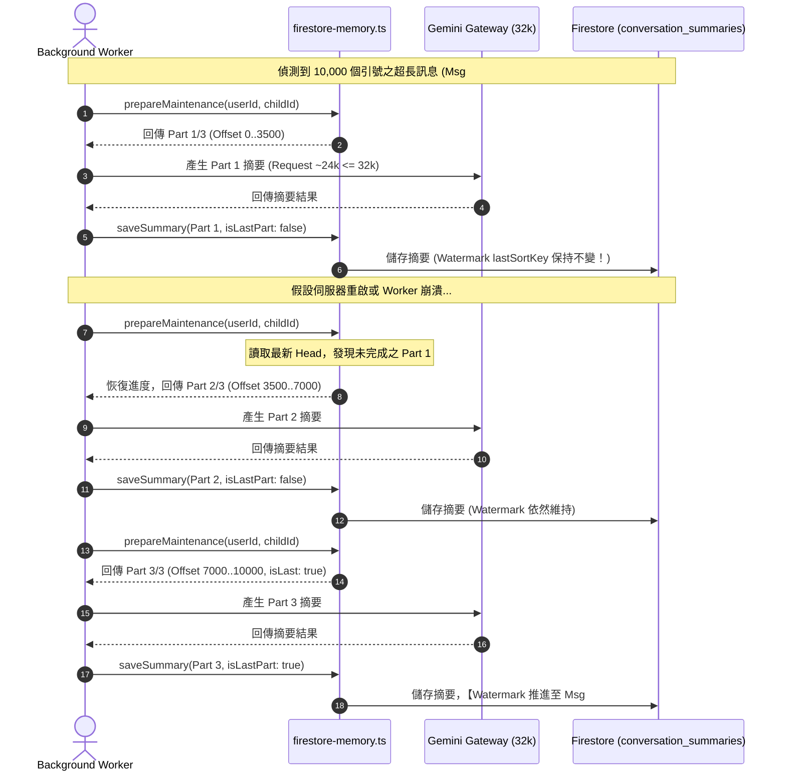

# REQ-005 對話歷史摘要前進性與長訊息分段架構藍圖 (Conversation Summary Progression & Segmentation Roadmap)

**文件版本**：v1.1.0  
**制定日期**：2026-11-03  
**關聯需求**：REQ-005（對話歷史摘要前進性、長訊息容納與多段覆蓋 / Backlog v0.11 §4.1）  
**目標模組**：`server/summary-window-helper.ts`, `server/firestore-memory.ts`, `server/private-summary-maintenance.ts`, `server/product-agent-tools.ts`  
**關聯 PR**：[PR #408](https://github.com/2NTTY/child-ai-caregiver/pull/408) (Phase 1), [PR #409](https://github.com/2NTTY/child-ai-caregiver/pull/409) (Docs Roadmap)

---

## 1. 摘要與問題本質 (Executive Summary & Root Cause)

在兒童照護 AI 系統（Child AI Caregiver）中，對話歷史摘要（Conversation Summary）是維持模型長期上下文與記憶一致性的基礎支柱。背景維護程序（`maintainSummary`，Recipe: `memory-refresh`）定期從資料庫撈取未摘要訊息（Uncovered Messages），透過 LLM 整理為精煉的歷史摘要，並推進指標水位（Watermark `lastSortKey`）。

### 1.1 核心痛點：為什麼舊版會卡死？
在舊版架構中，批次選取邏輯存在以下缺陷：
1. **硬編碼門檻（Hardcoded 12k Threshold）**：舊版限制整個批次的純 JSON 字元數不得超過 12,000 字元。
2. **長訊息不可分割性**：若使用者發送了一條單一長訊息（例如 7,000 個 Emoji，在 UTF-16 編碼下佔 14,000 字元；或包含數千字長文），該訊息體積大於 12,000 字元。
3. **水位停滯惡性循環（Permanent Stalling Loop）**：
   - 由於第一條訊息已超過 12,000，`prepareMaintenance` 無法容納，回傳空批次（或需要接續狀態）；
   - 水位指標 `lastSortKey` 無法推進，永遠停留在該條訊息之前；
   - 每次背景定時任務觸發時，重新撈取的第一條訊息仍然是該條長訊息，導致後續所有正常的日常對話完全無法被摘要，形成系統級永久卡死。

### 1.2 物理約束：LLM Gateway 32k 輸入上限
系統中所有對模型（Gemini / LLM）的呼叫均受 `server/agent-model-gateway.ts:172-175` 守護：
$$\text{Total Request Characters} \le \text{AGENT\_LIMITS.inputCharacters} = 32,000$$
若單次請求的字元數超過 32,000，Gateway 會立即丟出 `AgentStopped("input_limit")` 異常中斷執行。

---

## 2. 請求開銷精確分解與數學推導 (Request Sizing & Budget Derivation)

為徹底防止「為了解除卡死而放寬批次，卻導致請求超標擊穿 32k Gateway」，本系統進行了真實環境 Worker Request 的精確測量與預留量推導。

### 2.1 請求字元數結構 (Request Structure Breakdown)
Gateway 計算的 `agentRequestCharacters(request)` 格式為：
$$\text{Request} = \text{JSON.stringify}(\{\text{contents: request.contents}, \text{config: request.config}\})$$

在真實的 `memory-refresh` 背景 Worker 中，其結構包含：

```
+-------------------------------------------------------------------------------+
| Total Request (~23.8k - 30.9k Chars, Strictly <= 32,000 Chars)                |
+-------------------------------------------------------------------------------+
| 1. config (~8,992 Chars):                                                     |
|    - System Instruction (記憶維護提示詞、更正政策、不捏造承諾)                   |
|    - Tools Schema (stage_private_summary 參數驗證規格)                         |
|    - GenerationConfig (temperature, maxOutputTokens 等)                       |
+-------------------------------------------------------------------------------+
| 2. contents[0] Context Data (~412 - 634 Chars):                               |
|    - Purpose: 'private_incremental_summary'                                  |
|    - Coverage Metadata: { messageIds: string[], moreUncovered, repairOf }     |
|    - CurrentSources: 更正事實參照來源                                          |
|    - Data wrapper prompt overhead                                             |
+-------------------------------------------------------------------------------+
| 3. contents[1] User Payload (Source Messages):                                |
|    - Double-escaped JSON string containing { sourceMessages, instruction }    |
+-------------------------------------------------------------------------------+
```

### 2.2 雙重 Escape 膨脹效應 (Double-Escaping Expansion)
文字在進入 LLM 呼叫時經歷兩次序列化：
1. **第一次序列化**：訊息物件轉為 JSON 字串 `JSON.stringify({ sourceMessages: [...] })`。
   - 一般字元（ASCII、中文）：長度維持 1:1。
   - Emoji（如 😀）：UTF-16 雙字元（Surrogate Pair），長度為 2。
   - 雙引號 `"`：轉為 `\"`（長度變為 2 倍）。
2. **第二次序列化**：放入 `contents[0].parts[0].text` 後整體再被 `JSON.stringify(request)`。
   - 原本的 `\"` 轉為 `\\\"`（長度變為 4 倍）。

以純雙引號為例的膨脹倍率：
$$n \text{ 個引號} \xrightarrow{\text{第一次 JSON}} 2n \text{ 字元} \xrightarrow{\text{第二次 JSON}} 4n + \text{Envelopes} \text{ 字元}$$
- 5,300 個 `"`：Payload $\approx 4 \times 5,300 + 298 = 21,498$ 字元。
- 10,000 個 `"`：Payload $\approx 4 \times 10,000 + 298 = 40,298$ 字元（直接超過 32k）。

### 2.3 安全天花板數學推導 (Mathematical Derivation of Ceilings)
實測背景 Worker 之固定開銷：
- 基礎固定開銷：$C_{\text{fixed}} \approx 9,464 \sim 9,531 \text{ 字元}$。
- 每多一條訊息，在 `context.coverage.messageIds` 增加之 UUID 開銷：$C_{\text{per\_msg}} \approx 40 \text{ 字元}$。

為保證即使在最嚴苛的高跳脫字元情境下依然保有充足安全緩衝（Safety Margin $\approx 1,000 \text{ 字元}$），系統定義：
- **預留空間**：`SUMMARY_GATEWAY_RESERVE_CHARS = 10,500`
- **安全 Payload 天花板**：
  $$\text{SUMMARY\_SAFE\_REQUEST\_CEILING} = \text{AGENT\_LIMITS.inputCharacters} - \text{SUMMARY\_GATEWAY\_RESERVE\_CHARS} = 32,000 - 10,500 = 21,500$$

最大放行請求驗算：
$$\text{Max Total Request} = 21,500 + 9,531 = 31,031 \le 32,000 \quad (\text{裕度 } 969 \text{ 字元})$$

---

## 3. 三階段架構演進藍圖 (Three-Phase Architecture Roadmap)



---

## 4. 各階段深入技術規格 (In-Depth Technical Specifications)

### 4.1 Phase 1：有界首筆容納與安全門檻校準（PR #408 已落地）

#### 演算法狀態機 (`server/summary-window-helper.ts`)


#### Phase 1 已知邊界與工程取捨 (Known Scope Limitations)
1. **剩餘卡死窗口（5,301–5,559 個 `"`）**：
   - 估算 Payload 介乎 21,501 至 22,536 之間。
   - 在 master 上此長度可完成（Real Request 31.2k–31.9k），但 PR #408 為保留 1k 安全餘量避免生產環境不同 runtime 波動，在此版本先行判定超額停滯。
   - 5,560 個以上引號在 master 與 PR 均會超標卡死。此剩餘窗口交由 Phase 2 多段切分徹底根治。
2. **互動式 8k 路徑未改動**：`server/product-agent-tools.ts` 維持原狀，於 Phase 2 處理。

---

### 4.2 Phase 2：多段分段覆蓋與水位追蹤（詳細設計）

#### 1. 資料庫結構演進 (Firestore Schema Extension)
在 `conversation_summaries` 與記憶集合中擴充多段進度記錄：

```typescript
export interface ConversationSummaryPartMetadata {
  /** 關聯的原長訊息 ID */
  sourceMessageId: string;
  /** 當前分段序號 (從 0 開始) */
  partIndex: number;
  /** 預估總分段數 */
  totalParts: number;
  /** 當前分段涵蓋之文字起點字元 offset (以 Unicode code unit 計) */
  startOffset: number;
  /** 當前分段涵蓋之文字終點字元 offset */
  endOffset: number;
  /** 是否為該長訊息的最後一個分段 */
  isLastPart: boolean;
}

export interface ExtendedConversationSummary extends ConversationSummary {
  /** 當摘要涵蓋未完成之長訊息時攜帶分段中繼資訊 */
  partMetadata?: ConversationSummaryPartMetadata | null;
}
```

#### 2. Surrogate-Safe 智慧切分演算法
長訊息切分嚴格禁止按任意字元數截斷，必須遵循：
1. **Unicode 安全**：檢測 UTF-16 高低代理對（`0xD800` 至 `0xDFFF`），絕不從 Surrogate Pair 中間切斷，防止產生畸變字元。
2. **語義優先分段**：
   - 第一優先：段落換行 `\n\n`
   - 第二優先：單換行 `\n`
   - 第三優先：語句標點（`。`、`！`、`？`、`.`、`!`、`?`）
   - 最低兜底：在 10,000～12,000 字元區間內的最近空格或安全字元邊界。

#### 3. 水位推進與崩潰恢復時序圖 (Resumption & Progression Sequence)



#### 4. 前端互動 8k 工具適配 (`server/product-agent-tools.ts`)
- 前端 `read_context` 工具回應上限為：
  $$\text{Interactive Limit} = \text{toolResponseCharacters} - 512 \approx 8,000 - 512 = 7,488 \text{ 字元}$$
- 當對話歷史包含未完成之長訊息時，`read_context` 透過與 Helper 共用之分段邏輯，僅提取最新分段與已完成摘要，保證在 7.5k 限制內呈現完整連貫語義，不拋出溢出例外。

---

### 4.3 Phase 3：自適應滑動窗口與資源治理（長期交付）

#### 1. 動態 Token 密度調節 (Adaptive Window Sizing)
- 不同語言與字符的 Token 消耗比率迥異：
  - ASCII 英文：約 4 字元 = 1 Token
  - 中文漢字：約 1.5～2 字元 = 1 Token
  - 代碼與特殊符號：約 2～3 字元 = 1 Token
- Phase 3 將在 Helper 中引入輕量字元頻率分析，根據語言構成動態將純 JSON 目標門檻微調於 9,000～14,000 之間，使 LLM 上下文始終維持在最佳 Token 密度。

#### 2. 背景任務階梯逾時與熔斷機制 (Governance & Circuit Breaking)
- 連續遭遇 3 次超額分段失敗時，暫時標記該對話批次為 `quarantined`，發送告警並退避重試，避免無效輪詢消耗專案 API 配額。
- 設定 Worker 硬逾時階梯：單一分段上限 45 秒，整批維護上限 120 秒。

#### 3. 歷史微摘要合併與歸檔 (Summary Rollup & Retention)
- 當對話積累超過 50 個微批次摘要時，背景離線任務自動觸發 Macro-Rollup，將舊微摘要合併為月份/里程碑摘要，節省 Firestore 讀取開銷與前端載入延遲。

---

## 5. 測試驗收與驗證矩陣 (Verification Matrix)

| 測試案例 | 覆蓋階段 | 測試輸入 | 驗證標準 |
| :--- | :--- | :--- | :--- |
| **Test 1** | Phase 1 | 7,000 個 Emoji (14k UTF-16) | 不卡死，單筆獨立佔用批次，順利放行。 |
| **Test 2** | Phase 1 | 儲存摘要後之 Watermark 推進 | 儲存後 `lastSortKey` 正確推進，舊訊息不再被重覆撈取。 |
| **Test 3** | Phase 1 | 5,300、5,900 及 10,000 引號 | 5,300 放行；5,900 及 10,000 乾淨停滯於 `message_requires_continuation`。 |
| **Test 4** | Phase 1 | 30 × 1,000 ASCII 與 3 × 1,900 引號 | 普通訊息在 ~12k 截斷；多筆引號在第 2 筆截斷，杜絕膨脹。 |
| **Test 5** | Phase 1 | 端對端 7,000 Emoji 真實 Request 量度 | 透過真實 `maintainSummary` 測得完整 Request $\approx 23.8\text{k} \le 32,000$。 |
| **Test 6** | Phase 1 | 14k 修復與超額失效批次跳過 | 14k 修復成功；5,900 引號失效批次安全回傳 `null` 並維持隱藏。 |
| **Test 7** | Phase 1 | 端對端 5,300 引號真實 Request 量度 | 實測 Request $\approx 30,962 \le 32,000$，證實接近天花板時不崩潰。 |
| **Test 8** | Phase 2 | 10,000 引號分段覆蓋 (Chunking) | 成功切分為 3 個 Parts，依序摘要並在最後一段推進 Watermark。 |
| **Test 9** | Phase 2 | 分段中途中斷與冪等恢復 (Resumption) | 在 Part 2 模擬 Worker 重啟，能自 Part 2 接續完成，無重複資料。 |
| **Test 10** | Phase 2 | 前端 `read_context` 8k 互動式讀取 | 長訊息情境下 `read_context` 輸出嚴格 $\le 7,488$ 字元且語義完整。 |
| **Test 11** | Phase 3 | 50+ 摘要自動 Rollup 與存檔 | 歷史多批次成功壓縮為單一月度摘要，清理冷資料。 |

---

## 6. 結論與協作建議

本藍圖清晰指明了 REQ-005 的整體演進路徑：
- **Phase 1 (PR #408)** 是關鍵的**防禦性基石**：它修復了最普遍的卡死案例，並確立了 21,500 安全天花板與雙重 Escape 預估防護網，保證生產環境安全。
- **Phase 2** 將在 Phase 1 建立的安全邊界之上，透過資料庫欄位擴充與分段演算法，徹底消滅所有超大訊息卡死問題，完成前後端體驗閉環。
- **Phase 3** 則著眼於系統長期維護成本與效能最佳化。

所有團隊成員在進行 Phase 2 或後續模組開發時，應嚴格遵循本文件規範之架構邊界與資料契約。
