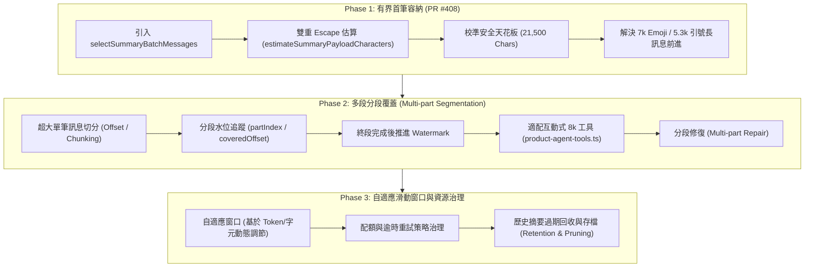

# REQ-005 對話歷史摘要前進性與長訊息分段架構藍圖 (Conversation Summary Progression Roadmap)

本文件定義 **REQ-005（對話歷史摘要前進性、長訊息容納與多段覆蓋）** 的核心架構設計、演進藍圖與技術契約，供專案團隊跨階段協作與維護遵循。

---

## 1. 背景與核心問題分析

### 1.1 現狀與痛點
在對話記憶管理系統中，背景 Worker（`maintainSummary`，Recipe: `memory-refresh`）負責將使用者的對話歷史分批整理為摘要，並推進覆蓋水位指標（Watermark Pointer `lastSortKey`）。

舊有機制存在以下嚴重瓶頸：
1. **單一長訊息卡死批次前進**：
   - 舊版 `prepareMaintenance` 預設訊息累積上限為純 JSON 12,000 字元。
   - 若使用者發送了一條單一超長訊息（例如 7,000 個 Emoji，在 UTF-16 下長達 14,000 單元；或大量引號等高跳脫字元），該訊息無法塞入 12,000 字元的累積窗口。
   - 系統因此回傳空批次或錯誤狀態，導致 Watermark 永遠停留在該訊息之前，後續所有新對話均無法被摘要，形成**永久停滯（Stall）**。
2. **LLM Gateway 32k 輸入上限約束**：
   - `server/agent-model-gateway.ts` 嚴格限制單一請求字元數不得超過 `AGENT_LIMITS.inputCharacters = 32000`。
   - Worker 請求本身包含 System Instruction、Tool Schema、Context 元數據與 JSON Envelope，固定開銷達 **~9,500 字元**。
   - 特殊跳脫字元（如大量雙引號 `"`）在經過雙重 JSON 序列化（`JSON.stringify` 內包至請求文字）後，字元數會膨脹約 4 倍。若隨意放寬累積門檻，極易擊穿 32k Gateway 造成 `input_limit` 崩潰。
3. **互動式工具（Interactive Tool）8k 上限**：
   - 在前端互動路徑中，`server/product-agent-tools.ts` 的 `read_context` 工具回應受限於 `toolResponseCharacters - 512`（約 7.5k 字元），無法直接承載大型批次。

---

## 2. REQ-005 三階段演進架構 (Three-Phase Architecture)

為兼顧**即時解除線上停滯**與**長期分段覆蓋完整性**，REQ-005 劃分為三個循序漸進的階段：



---

## 3. 階段詳細規劃與交付目標

### 3.1 Phase 1：有界首筆容納與安全門檻校準（已於 PR #408 交付）

#### 目標
在不增加模型配額、不膨脹普通多訊息批次的前提下，即時修復合法長訊息卡死問題，並嚴格保障放行請求絕不超過 Gateway 32k 限制。

#### 核心技術契約
1. **多訊息累積限制保持 12k**：
   - 多條訊息累積依然以純 JSON 12,000 字元為截斷點（`SUMMARY_BATCH_TARGET_CHARS = 12000`），杜絕多條普通對話膨脹為 23k+ 的風險。
2. **有界首筆容納 (Bounded First-Item Accommodation)**：
   - 若佇列中的第一條訊息本身大於 12,000 字元，只要其雙重 Escape 後的估算 Payload 不超過安全天花板，便允許該單一長訊息單獨佔用整個批次執行摘要。
3. **精準安全天花板推導**：
   - 實測背景 Worker（Recipe: `memory-refresh`）固定開銷為 ~9,464 字元（每多一條訊息約 +40 字元）。
   - 保留約 1,000 字元安全緩衝，設定固定預留量：`SUMMARY_GATEWAY_RESERVE_CHARS = 10500`。
   - 導出安全 Payload 天花板：
     $$\text{SUMMARY\_SAFE\_REQUEST\_CEILING} = 32,000 - 10,500 = 21,500$$
   - 任何放行批次的總請求字元數保證 $\le 32,000$（實測 7k Emoji 為 ~23.8k，5,300 引號為 ~30.9k）。
4. **全候選雙重 Escape 預估防護**：
   - 候選訊息（無論首筆或後續累積）均透過 `estimateSummaryPayloadCharacters` 模擬 LLM 請求雙重序列化字元數。
   - 截擊單筆超額（如 5,900 及 10,000 個引號）與多筆逃逸膨脹（如 3 × 1,900 個引號在第 2 筆安全停截）。
5. **Phase 1 已知邊界**：
   - 單筆估算 $> 21,500$ 的超額訊息（如 10,000 個引號，以及 5,301–5,559 引號邊界窗口）回傳 `message_requires_continuation`，維持安全停滯，留待 Phase 2 分段支援。

---

### 3.2 Phase 2：多段分段覆蓋與互動路徑適配（下一步規劃）

#### 目標
徹底根除任何長度訊息的卡死問題，支援超長單一訊息的多段連續摘要，並解決前端互動路徑的 8k 工具限制。

#### 核心模組與設計
1. **多段分段摘要演算法 (Multi-part Message Chunking)**：
   - 當單一訊息的 Payload 超過安全門檻（例如 18,000 字元）時，Helper 將其依照語義邊界（換行、句號）或安全 UTF-8 字符邊界切分為多個片段（Parts）。
   - 支援 Surrogate Pair 安全切分，防止切斷 Emoji 或特殊 Unicode 字元。
2. **分段水位與進度追蹤 (Coverage Offset Tracking)**：
   - 在 `ConversationSummary` 或資料庫結構中引入追蹤欄位：
     ```typescript
     interface SummaryCoverageProgress {
       messageId: string;
       partIndex: number;
       totalParts: number;
       coveredOffset: number;
       isComplete: boolean;
     }
     ```
   - 第一段摘要完成後，記錄已覆蓋片段；**只有當最後一段完成後，Watermark (`lastSortKey`) 才正式推進至下一條訊息**。
   - 若中途發生 Worker 重試或崩潰，可自上次記錄的 `partIndex` 恢復，避免重複總結或狀態遺失。
3. **互動式工具 8k 路徑適配 (`server/product-agent-tools.ts`)**：
   - 修改 `read_context` 工具中的 `fits()` 邏輯（約 L313–330）。
   - 使其能根據 `toolResponseCharacters - 512`（約 7.5k）的硬性約束，自動調用分段邏輯，避免直接截斷拋出例外。
4. **失效批次分段修復 (Multi-part Repair)**：
   - 升級 `firestore-memory.ts` 中的 `repairInput`。當被修改的 Fact 影響到超長歷史批次時，支援分段重構修復，不再只能靜態回傳 `null`。

---

### 3.3 Phase 3：自適應滑動窗口與資源治理（長期交付）

#### 目標
提升系統在超大規模歷史對話下的運算效率與儲存健康度。

#### 核心模組與設計
1. **動態自適應窗口 (Adaptive Sizing)**：
   - 結合模型實際使用的 Tokenizer 估算比率（ASCII vs 中文 vs Emoji vs 代碼），動態調節每一批次的字元數量，達到最高摘要密度。
2. **資源配額與逾時治理 (Resource & Quota Governance)**：
   - 建立背景 Worker 呼叫頻率限制與階梯逾時（例如 90s/60s）。
   - 防止惡意或異常連續大量長訊息導致 Worker 耗盡後端配額。
3. **冷資料存檔與垃圾回收 (Retention & Archiving)**：
   - 針對超過 1 年或已封存專案的細粒度批次摘要進行合併（Rollup）或歸檔，降低 Firestore 儲存壓力與查詢開銷。

---

## 4. 模組職責劃分表

| 模組檔案 | 所屬層級 | 職責與契約 |
| :--- | :--- | :--- |
| `server/summary-window-helper.ts` | 領域演算法層 (Pure Logic) | 批次選取、雙重 Escape 預估、安全天花板常數定義、未來多段切分邏輯（無 I/O 依賴）。 |
| `server/firestore-memory.ts` | 儲存與狀態層 (Persistence) | 事務內執行 `prepareMaintenance`、管理 Watermark 指針、執行批次修復 (`repairInput`)。 |
| `server/private-summary-maintenance.ts` | 背景任務層 (Worker Runtime) | 背景任務領取（Claim）、調用 LLM 生成摘要並調度 `stage_private_summary`。 |
| `server/product-agent-tools.ts` | 互動工具層 (Interactive Tools) | 前端對話期間的即時上下文讀取（`read_context`），8k 工具回應硬限制防護。 |
| `tests/summary-progress.test.ts` | 測試驗證層 (Verification) | 端對端真實請求量度、極限邊界測試、多訊息防膨脹與分段回歸防護。 |

---

## 5. 結論

本架構藍圖確立了 REQ-005 的長遠演進方向：
- **Phase 1** 著重於**建立防禦工事與安全放行**（消除阻塞，守住 32k 底線）。
- **Phase 2** 著重於**建立完整分段覆蓋能力**（消滅剩餘停滯窗口，統一互動路徑）。
- **Phase 3** 著重於**全系統資源效率與維護自動化**。

團隊成員進行後續開發時，應嚴格遵循上述模組職責劃分與安全邊界推導原則。
